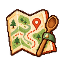
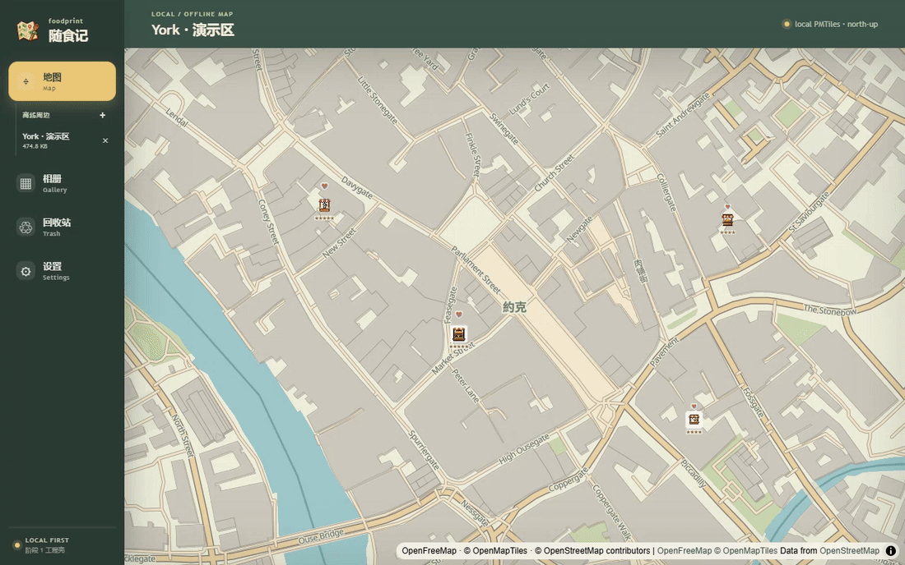
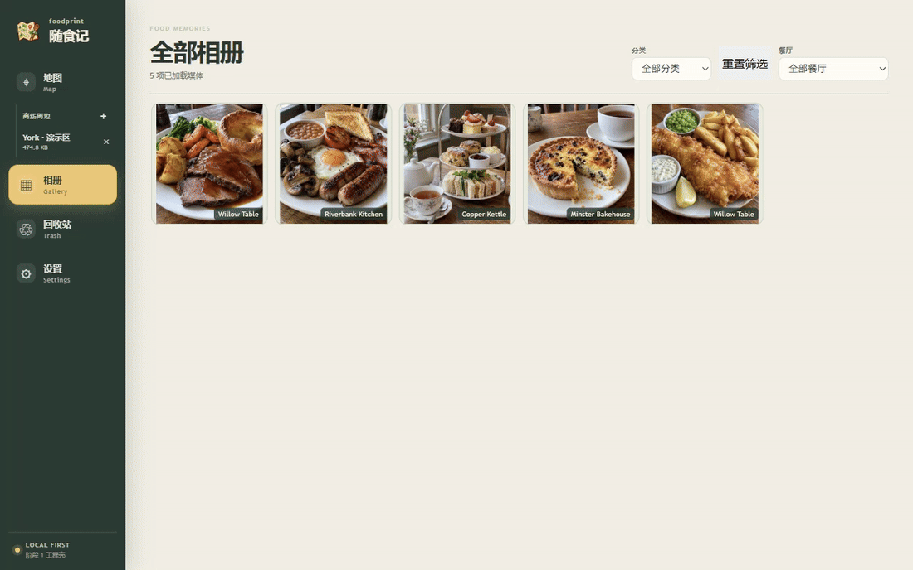

  

<h1 align="center">随食记 · foodprint</h1>

<strong>A private food diary on a real map.</strong>

<a href="README.md">简体中文</a> · English

  <a href="#features">Features & Demos</a> ·
  <a href="#start">Download & Usage</a> ·
  <a href="#why">Motivation & Related Research</a> ·
  <a href="#credits">Acknowledgments & License</a>

  
  

---

These days, there isn't much I feel like buying. I don't feel much like playing games either. But I still look forward to a good meal. Walking into a little place I like, ordering a few dishes I've been wanting, and taking my time over them is one of the warmest parts of everyday life for me.

Sometimes, seeing a photo of a restaurant long afterward brings back what I ate that day, the streets I walked, and how I felt. I want to keep those experiences, so that years from now I still have a way to remember them.

So I made FoodMap: a private food diary on a real map. I can mark the restaurants I've visited and record the time, photos, and whatever I want to say about each meal. As the entries grow, ordinary streets gradually become my own map of food memories.

When I return to a familiar place on the map someday, I hope I'll remember more than the food: that small, warm stretch of life.

## ✨ Features & Demos

### Map and meal entries

Mark a restaurant on the map, pick a little shop icon you like, and leave a rating and your impressions. Each visit gets its own entry; open one to see the date and time, the photos, and what you wrote that day.

### Find that restaurant from a photo

Filter photos by restaurant, open one, and choose “在地图中查看” (View on map) to return to the restaurant and the entry for that meal.

## 🚀 Download & Usage

For **Windows x64**. Current version: **0.1.0**.

1. **Install and open.** Run `随食记_0.1.0_x64-setup.exe`, follow the installer, then open “随食记” from the Start menu.
2. **Find the place you want to remember.** Click “+” in the map sidebar to search for a location, then choose “缓存此处周边” (Cache nearby). You can view the downloaded area offline afterward.
3. **Record your first meal.** Right-click the map to add a restaurant. Open it, add a meal entry, fill in the time and your impressions, then attach photos or videos.
4. **Keep a backup.** Export a backup from Settings and save it somewhere you can find again.

Your dining records and media stay on your computer; location searches and new map downloads use the internet. See [data and backups](DATA_SAFETY.md) for more details, or [development and builds](docs/development.md) to run from source.

## 💡 Motivation & Related Research

**References**

**1. Food-evoked nostalgia**  
Reid et al., 2023, *Cognition and Emotion*, 37(1), 34–48. [Original paper](https://doi.org/10.1080/02699931.2022.2142525). Across three studies, food evoked nostalgia tied to personal experiences, with a predominantly positive emotional tone.

**2. Food nostalgia and food comfort: the role of social connectedness**  
Reid et al., 2026, *Cognition and Emotion*, 40(1), 217–225. [Original paper](https://doi.org/10.1080/02699931.2025.2479170). Four studies examined food nostalgia and comfort. Two experiments found that recalling and describing nostalgic food experiences could bring comfort by strengthening a sense of connection with other people.

**3. What versus where: Investigating how autobiographical memory retrieval differs when accessed with thematic versus spatial information**  
Sheldon and Chu, 2017, *Quarterly Journal of Experimental Psychology*, 70(9), 1909–1921. [Original paper](https://doi.org/10.1080/17470218.2016.1215478). The study compared event themes and places as memory cues. Themes prompted more memories and more details overall; places prompted faster access to memories and a higher proportion of details about a specific episode.

**Design References & Application**

The research on place cues feels especially close to why I chose a map: when I remember a restaurant, the streets around it may be part of the memory too. Keeping separate entries for different visits ties each meal's photos and notes to a specific place and experience. The food nostalgia research also echoes why I want to keep these records: the warmth of a meal is often tied to the people and the life around it.

## 🙏 Acknowledgments & License

Thank you to OpenFreeMap, OpenMapTiles, and OpenStreetMap contributors for the map resources. Licenses and attribution for the open-source components, maps, and fonts are collected in the [third-party notices](THIRD_PARTY_NOTICES.md).

Copyright (C) 2026 **Lucian W. (lucian-d-w)**. Original project code and project-owned artwork are licensed under **[GPL-3.0-only](LICENSE)**, GNU GPL version 3 only. Third-party code and assets retain their respective licenses.
